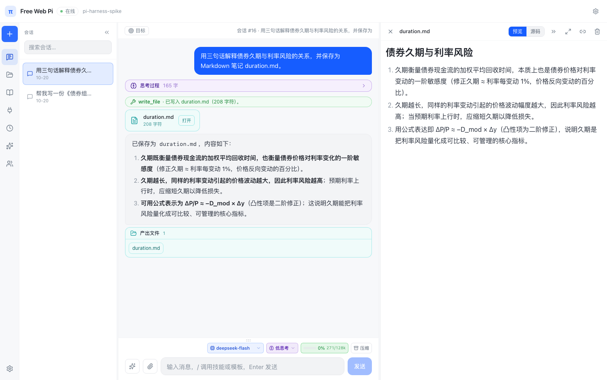

<div align="center">


# Durable Pi（自架的 pi agent 工作台）

[](https://github.com/dogbro2/durable-pi/releases) [](https://github.com/dogbro2/durable-pi/stargazers) [](LICENSE) [](https://github.com/dogbro2/durable-pi/actions/workflows/deploy.yml)

[English](README.md) · **繁體中文** · [快速開始](#快速開始) · [部署](#部署)

[](https://deploy.workers.cloudflare.com/?url=https://github.com/dogbro2/durable-pi)

<sub>一鍵部署到自己的 Cloudflare 賬號；部署時 Build command 填 <code>npm run build:web</code>，詳見[部署](#部署)</sub>

</div>

把 [pi](https://github.com/earendil-works/pi) 的 **durable harness 核心**跑在 Cloudflare Worker 上：會話、工具呼叫、記憶、檔案全部持久化在 Durable Object 的 SQLite 裡，不依賴任何外部資料庫。

- **執行成本**：Cloudflare 免費額度內；模型端點由你自己在「設定 → 模型」新增（任何 OpenAI 相容服務，按量計費）
- **自架**：沒有共用公開例項，部署進你自己的 Cloudflare 賬號（見[部署](#部署)）

> 本專案是社群專案，與 Cloudflare, Inc. 無隸屬關係；Cloudflare、Workers、Durable Objects 是其商標。



---

## 功能

| 模組 | 能力 |
|---|---|
| 會話 | 多會話隔離、首條訊息自動命名（前 24 字）、重新命名、刪除、**按會話選擇模型**（在設定裡新增的任一供應商模型） |
| 對話 | SSE 流式逐字輸出、**可摺疊思考過程**、**吸頂計劃清單**（`update_plan`）、工具呼叫即時 pill（含 codemode 內嵌呼叫）、**產出檔案卡**、完整 Markdown（表格/任務列表/程式碼複製）、圖片輸入（貼上或上傳，自動壓縮 ≤1568px） |
| 執行 | `codemode`：模型寫 JavaScript 在 QuickJS 沙箱裡跑，指令碼內可 `await tools.<name>()` 呼叫其它工具；`dispatch_tasks`：2–4 個獨立子任務並行分派給子代理後彙總 |
| 網頁 | `web_search` 聯網搜尋 + `web_fetch_page` 抓取正文（端點在「設定 → 工具服務」填，留空即關閉）；`http_fetch` 直接抓取；**Browserbase MCP** 雲端瀏覽器（導航/點選/提取，無需本地 Chrome） |
| 記憶 | `remember` / `recall` + 每 6 條自動 `reflect` 抽取長期事實（帶去重） |
| 檔案 | 按會話隔離的虛擬檔案系統（`write_file` / `read_file` / `list_files`），右欄可預覽 Markdown 與 HTML；**左欄「全部檔案」跨會話彙總當前使用者的所有產出**；Markdown / HTML 可生成**走你自己域名**、帶有效期的公開分享連結；模型可用 `share_file` / `share_conversation` 直接產出連結卡（同一檔案複用未過期 token） |
| 知識庫 | **每個使用者獨立的知識庫**（每人一個 DO）：貼上資料自動分塊 + 中文全文索引（FTS5 / bm25），模型側 `kb_search` / `kb_add` / `kb_list` / `kb_delete`；**每輪按使用者訊息自動預檢索並注入前 3 段**（設定→對話可關）；左欄「知識庫」可檢索、檢視全文、刪除 |
| 能力 | **能力登錄檔**（內建/資料/協議三類彙總）、**提示模板**（`/` 展開，支援 `$1` 佔位）、**規則檔案**（每輪注入）、自定義技能（`SKILL.md` 規範）+ 一鍵安裝 `badlogic/pi-skills` 社群技能；模型按需 `load_skill`，也可在輸入框用 `/技能名` 顯式呼叫 |
| 擴充套件 | 任意 **MCP** 伺服器（Streamable HTTP，支援自定義請求頭） |
| 定時 | Durable Object alarm 驅動的定時任務（每天 HH:MM / 每隔 N 分鐘） |
| 其他 | **左側工具欄**（新會話/全部檔案/知識庫/會話/連線/定時/技能/使用者/設定）、**設定頁**（分 tab：通用/對話/模型/記憶/資料）、**模型供應商管理**（任意 OpenAI 相容端點，CCswitch 式切換）、一鍵清空記憶、只讀分享連結（會話 / Markdown / HTML，可設有效期，走自己的 Cloudflare 域名）、Markdown 匯出、全量備份/恢復、四套主題（深色/淺色/米黃/午夜藍，Arco 位元組色卡）、訪問密碼 + 邀請碼多使用者（獨立空間） |

---

## 架構

```
瀏覽器
  │  https://<你的 Worker 域名>           ← 可繫結自定義域名 / pages.dev 反代
  ▼
Cloudflare Worker（靜態前端 + API 入口）
  ├── 靜態資源：dist-web（React + Vite + Tailwind）
  └── /api/*、/s/* → Durable Object
                     ├── pi-durable Harness（會話 / 任務 / 工具排程）
                     ├── Storage = openDurableObjectSqliteStorage（DO SQLite）
                     ├── 模型：pi-ai provider（端點由使用者在設定裡填）
                     ├── codemode：QuickJS WASM 沙箱
                     └── MCP 客戶端（Streamable HTTP）
```

**關鍵設計**

- **持久化**：`@earendil-works/pi-durable` 的 `Storage` 介面 + 官方 DO SQLite 介面卡，會話/任務提交前落盤，程序重啟自動續跑
- **工具迴圈**：pi-durable 的 `generation` 任務原生支援多步工具呼叫與 `tool_search` 漸進披露
- **擴充套件注入**：擴充套件必須在 `Harness.open` 之前 `registry.install`，否則已存在會話解析不到
- **自愈**：儲存類錯誤觸發 `close + reopen`；定時任務遇到會話忙會順延，避免併發寫壞會話

---

## 快速開始

從零到本機可用約三分鐘（依賴安裝 1–2 分鐘，前端構建十秒內，首次啟動 `wrangler dev` 約 10–20 秒）。

```bash
git clone https://github.com/dogbro2/durable-pi.git
cd durable-pi
npm install

# 前端必須先在本地構建：wrangler 把 dist-web/ 當靜態資產目錄，缺了會直接報錯
npm run build:web

# 本地密碼（只寫入 .dev.vars，不會提交）
echo "ACCESS_PASSWORD=你的訪問密碼" >> .dev.vars
# 本機想免密碼除錯時再加：echo "PI_ALLOW_OPEN=1" >> .dev.vars

npx wrangler dev             # Worker + DO：http://localhost:8787
```

開啟 http://localhost:8787 、輸入 `ACCESS_PASSWORD` 即可對話。確認服務起來了：

```bash
curl http://localhost:8787/api/auth
# {"required":true,"authenticated":false,"owner":false}   ← 密碼已生效，尚未登入
```

改前端時用熱更新：另開一個終端跑 `npm run dev:web`（http://localhost:5173，`/api` 已代理到 8787）；`wrangler dev` 讀的是 `dist-web/`，改完需重跑 `npm run build:web`。

**模型要自己配**：v1.1.0 起沒有內建供應商，也不再讀 `DEEPSEEK_API_KEY`。啟動後到 **設定 → 模型與工具服務** 新增一個 OpenAI 相容端點（Base URL、API Key、模型 ID），沒配之前聊天入口只會提示你去配。同頁的「工具服務」填了才啟用搜尋 / 網頁抓取 / 自動記憶，留空就完全關閉。

**知識庫**：預設只有 FTS5 關鍵詞檢索（本地 SQLite，零外部呼叫）。`wrangler.jsonc` 不再帶 `AI` / `Vectorize` 繫結，因此 PDF / DOCX 匯入與向量檢索預設不可用，只收 Markdown / 純文字；需要時把繫結加回來即可，程式碼會自動啟用。

金標迴歸（單元 + 介面，約 40 秒）：

```bash
npm test
```

---

## 部署

### 一鍵部署到自己的賬號

點首屏的 **Deploy to Cloudflare** 按鈕，或用[這個連結](https://deploy.workers.cloudflare.com/?url=https://github.com/dogbro2/durable-pi)。Cloudflare 會把倉庫複製到你的 GitHub 賬號，用 Workers Builds 構建並部署：

- **Build command**：填 `npm run build:web`（倉庫沒有 `build` 指令碼，留空會因缺 `dist-web/` 而失敗）
- **Deploy command**：保持預設 `npx wrangler deploy`
- 部署完成後到 Worker → Settings → Variables and Secrets 新增 `ACCESS_PASSWORD`。**不設 `ACCESS_PASSWORD` 時 Worker 直接回 503 拒絕服務**（只有本機除錯才用 `PI_ALLOW_OPEN=1` 放開）；改完變數需重新部署一次

Durable Objects 會按 `wrangler.jsonc` 自動建立。不需要 Workers AI，也不需要先手建 Vectorize 索引。

### 命令列部署

```bash
npm install
npm run build:web                      # 手動部署同樣要先構建前端
npx wrangler secret put ACCESS_PASSWORD
npx wrangler secret put BUILD          # 可選：構建號，用於判斷線上是否更新
npx wrangler deploy
```

推送 `main` 會自動部署（`.github/workflows/deploy.yml`），需要倉庫 secrets：`CLOUDFLARE_API_TOKEN`、`CLOUDFLARE_ACCOUNT_ID`。

### 可選：啟用 Workers AI 與 Vectorize

`wrangler.jsonc` 預設**不帶**這兩個繫結，預設安裝也用不到它們：知識庫走 SQLite FTS5，PDF/DOCX 不支援。要開就是把設定加回來，**不用改程式碼**（對應程式碼路徑還在，未繫結時自動降級）。

| 繫結 | 開啟什麼 | 沒有它時 |
| --- | --- | --- |
| `AI`（Workers AI） | PDF / DOCX 轉 Markdown（`env.AI.toMarkdown`）＋ bge-m3 向量 | PDF/DOCX 匯入回 `501 ai_unavailable`，只能上傳 Markdown / TXT 或直接貼正文 |
| `KB_VEC`（Vectorize） | 知識庫的 `vector`（語意）與 `hybrid`（RRF 混合）檢索 | 檢索固定走 FTS5 關鍵詞（bm25 + 中文 bigram） |

向量檢索**兩個都要**：向量由 `AI` 生成，索引由 `KB_VEC` 存放；只有 `AI` 時可以解析 PDF/DOCX，但 `vector` / `hybrid` 模式仍不會生效。

**步驟 1：每個賬號建一次索引**（名字與維度必須和 `wrangler.jsonc` 一致，不會自動建立）：

```bash
npx wrangler vectorize create pi-kb --dimensions=1024 --metric=cosine
```

**步驟 2：把兩個繫結加回 `wrangler.jsonc`：**

```jsonc
"ai": { "binding": "AI" },
"vectorize": [{ "binding": "KB_VEC", "index_name": "pi-kb" }],
```

**步驟 3：重新部署**：`npm run build:web && npx wrangler deploy`。

**步驟 4：在應用裡切換**：設定 → 記憶 → 知識庫檢索，選「向量」或「混合」，再點一次「重建向量索引」把歷史分塊補建（每次 200 段，可重複點；`GET /api/kb/status` 回報 `indexed` 與 `pending`）。

注意：

- `wrangler dev` 沒有可用的 `AI` / `Vectorize` 繫結，本地向量檢索是空的，要在部署後的例項驗證。
- 想臨時關掉向量（即使繫結在）：設環境變數 `CF_DISABLE_VECTOR=1`，測試套件就是這樣跑的。
- 切回 `fts` 只是不再查向量，**不會刪**已建的向量。
- 費用：embedding 與查詢計入 Workers AI，Vectorize 另有自己的額度，開大索引前先確認計價。

---

## HTTP API

除 `/api/auth`、`/api/login`、`/s/*` 外，均需登入 cookie。

| 方法 | 路徑 | 說明 |
|---|---|---|
| GET | `/api/auth` | 是否需要登入 / 當前是否已登入 |
| POST | `/api/login` | `{password}` → 下發簽名 cookie |
| GET | `/api/bootstrap?sessionId=` | 首屏聚合：一次返回 `session` / `entries` / `sessions` / `files` / `memories` / `approvals` / `settings` / `plan` / `goal` / `questions` / `prompts` / `rules` / `customTools` / `skills` / `automations` / `mcpServers` / `models`；單個面板失敗時該欄位為 `null` 或 `[]`，`errors` 裡只給穩定碼 `internal_error` / `unavailable`（異常原文只進服務端日誌，不回傳表名或 SQL） |
| GET | `/api/sessions` | 會話列表 |
| POST | `/api/sessions` | 新建會話 |
| PATCH / DELETE | `/api/sessions` | 重新命名 / 刪除。刪除會級聯清空該會話的分享、檔案、計劃、審批/許可、問題與 KB 命中旁路；響應 `{ok:true,deleted:{shares,files,plans,approvals,approvalGrants,questions,kbRefs}}` |
| POST | `/api/chat` | `{message, sessionId?, images?}` → `{answer, tools}`；同會話已有對話在跑時直接 409 `{code:"chat_busy", retryable:true}`，不再排隊 |
| POST | `/api/chat/stream` | 同上，SSE：`text` / `tool_start` / `tool_end` / `done`；`done` 在本輪命中知識庫時透傳 `kbRefs`（與 entry 同一份，未命中不帶該欄位）；同會話併發時與 `/chat` 一樣在建流前返回 409 `chat_busy` |
| GET | `/api/entries?sessionId=` | 會話轉錄；命中知識庫的 assistant entry 帶 `kbRefs: {docId, chunkId, chunkSeq, title, source?}[]`，未命中不帶該欄位 |
| GET | `/api/files?sessionId=` | 工作臺檔案列表 |
| GET | `/api/files/content?sessionId=&name=` | 檔案內容 |
| GET | `/api/files/all?q=` | 當前使用者所有會話的檔案（跨會話總覽） |
| GET / POST / DELETE | `/api/kb` | 使用者知識庫：文件列表 / 入庫 / 刪除。入庫響應帶 `chunks`、`vectorized`、`pending`：向量模式下本次會把該文件所有未建向量的分塊分批建完；中途失敗時保留已完成批次，剩餘量看 `pending` |
| POST | `/api/kb/ingest` | 匯入檔案（`multipart/form-data` 的 `file`：PDF / DOCX / MD / TXT）或網頁（JSON `{url}`），服務端解析後入庫；同 source 同正文返回 `updated:false` 不重複入庫，正文變化則原地替換並返回 `updated:true`；向量進度同 `/api/kb` 的 `vectorized` / `pending` |
| GET | `/api/kb/doc?id=` · `/api/kb/search?q=` | 知識庫文件全文 / 檢索片段 |
| GET | `/api/kb/status` · `POST /api/kb/reindex?limit=` | 向量索引進度（`total` / `indexed` / `pending`）與手動補建（單次最多 500 段，剩餘繼續輪詢） |
| GET | `/api/kb/prefetch?q=` | 本輪會自動注入的知識庫參考資料（除錯 / 排查用） |
| GET / POST / DELETE | `/api/skills` | 技能增刪查（相容舊欄位；每條新增 `lastInvokedAt`）。`POST` 先審計再入庫（256 KiB 上限，超限 413），落庫的是真實 `auditStatus`/`auditReport`；同名覆蓋後 `GET /skills` 與 `/skills/hub` 判定一致，`blocked` 不進入模型提示詞索引 |
| GET | `/api/skills/hub` | Skill Hub 市場：目錄快照 + 已安裝合併；`q` / `runtime` / `tag` / `audit` / `source` / `origin` / `installed` / `sort` / `limit` / `offset`；`runtime` 接受 `prompt/javascript/typescript/python/shell/binary/other`，列表零抓取 |
| GET | `/api/skills/:name/audit` | 單技能審計：已安裝走本地重審計（`auditSource:"local"`），僅目錄存在時返回快照（`"catalog"`），不存在 404 |
| POST | `/api/skills/import` | `{url}` 或 `{manifest, content}`，**先審計再入庫**；`blocked` → 422 `{ok:false, installed:false, code:"audit_blocked", details:{audit}}` 且不寫庫；同名不同雜湊 409，`overwrite:true` 覆蓋 |
| GET | `/api/skills/community` | 社群技能目錄（badlogic/pi-skills）：8 條固定 `audit_status:"blocked"`（需要本地執行時），不可安裝 |
| GET | `/api/metrics/skill-hub?days=7` | 技能域指標：`{hubViews, installOk, installBlocked, blockedRatio, installed, called7d}`；與分享計數完全獨立 |
| GET / POST / DELETE | `/api/mcp` | MCP 伺服器配置（支援 `headers`） |
| GET / POST / DELETE | `/api/providers` · `/api/providers/activate` | LLM 供應商（自定義 OpenAI 相容端點） |
| GET / POST | `/api/settings` | 全域性設定（網頁搜尋開關 `webSearch`、思考檔位 `thinkingLevel`、分享頁署名 `displayName`、分享預設有效期 `shareTtlSeconds`） |
| GET | `/api/plan?sessionId=` | 當前會話的分步計劃 |
| GET | `/api/context?sessionId=` | 上下文佔用估算（百分比 / 視窗） |
| GET / POST / PATCH / DELETE | `/api/automations` | 定時任務。每行帶 `last_run_at` 與 `last_status`（`ok` 成功 / `failed` 異常 / `deferred` 會話忙順延，老資料為 `null`）；`deferred` 只推後 `next_run_at`，不改 `last_run_at`。PATCH `{id, name?, prompt?, schedule?, sessionId?, enabled?}`：欄位均可選，只傳 `enabled` 時與舊啟停語義完全一致；改 `schedule` 後按新排程重算 `next_run_at`（daily 按 UTC+8）並重掛 alarm，只改名稱/提示詞/會話則保留原 `next_run_at`；校驗失敗 400 且不落庫，返回 `{ok:true, automation:{id,name,prompt,schedule,sessionId,enabled,last_run_at,last_status,next_run_at}}` |
| POST | `/api/share` · GET `/s/<token>` | 只讀分享（`kind=conversation/file`，`ttlSeconds` 可選，不傳用 `shareTtlSeconds` 設定、0 = 永久；`theme` 記錄分享頁配色；頁尾署名 + 生成時間）。每次有效開啟計入 `openCount` / `lastOpenedAt`；同一 IP（`CF-Connecting-IP`，反代看 `X-Forwarded-For` 首跳）1 小時內只計 1 次，庫裡只存雜湊 |
| GET | `/api/shares?sessionId=&kind=&name=` | 未過期的分享連結（開啟彈窗時複用） |
| GET | `/api/shares/all?status=active\|expired\|all` | 全量分享清單（預設 `active`）：`{ shares: [{ token, kind, name, expiresAt, theme, createdAt, openCount, lastOpenedAt, sessionId, url }] }`，`url` 為相對路徑 `/s/<token>` |
| DELETE | `/api/shares/<token>` | 撤銷分享 → `{ ok: true }`，立即生效（原連結 404）；越權 403，不存在 404 |
| GET | `/api/export?format=md` | 匯出 Markdown |
| GET / POST | `/api/backup` · `/api/restore` | 全量備份 / 合併恢復 |
| GET | `/api/version` | 線上構建號（CI 注入 git SHA） |
| GET / POST / DELETE | `/api/users` · `POST /api/users/reset` | 邀請使用者管理（僅主人；碼只返回一次）。`DELETE?id=` 吊銷訪問：**先刪除該使用者全部分享（`/s/*` 立即 404），再刪登錄檔行**；任一步失敗返回 502 可重試，重試期間不會留下可讀的舊分享。**資料預設保留**；響應 `{ok,id,deleted,shares,retained:{sessions,files,kbDocs,...}}`，重複呼叫冪等 |
| GET | `/api/users/export?id=` | 匯出某使用者的完整備份（僅主人；與 `/api/backup` 同形，purge 前留檔用） |
| DELETE | `/api/users/data?id=&confirm=<id>` | 顯式清空某使用者 DO 的全部資料（僅主人；必須已吊銷且 `confirm` 等於使用者 id）。不可逆；返回 `{ok,id,purged:{...}}`，重複呼叫為 0 |

**錯誤響應（NERE-79）**：所有端點失敗時統一返回 `{ error, code, details?, retryable? }`，HTTP 狀態碼語義不變（400 / 403 / 404 / 409 / 413 / 415 / 422 / 500 / 502 / 504）。`error` 是可直接展示的中文文案，`code` 是穩定分支鍵（如 `bad_request` / `not_found` / `unsupported_type` / `audit_blocked` / `chat_busy`），`details` 只在需要結構化原因時出現（如技能審計的 `details.audit`），`retryable` 僅用於可重試的上游失敗。相容期保留舊欄位：`POST /api/kb/ingest` 另帶 `ok:false` 與 `message`，`POST /api/skills/import` 另帶 `ok:false` 與 `installed:false`；未知路徑同樣返回 `{error:"not found", code:"not_found"}`。

---

## 內建工具

`now` · `remember` · `recall` · `kb_search` · `kb_add` · `kb_list` · `kb_delete` · `update_plan` · `dispatch_tasks` · `list_skills` · `load_skill` · `install_skill` · `web_search` · `web_fetch_page` · `http_fetch` · `write_file` · `read_file` · `list_files` · `codemode` · `tool_search` · `set_goal` · `complete_goal` · `report_goal` · `share_file` · `share_conversation` · `ask_user`，以及所有已配置 MCP 伺服器的工具（`mcp__<伺服器>__<工具>`）。

共 26 個內建工具；另可在左欄「技能 → 自定義工具」用 JS 寫自定義工具。

---

## 注意事項

- **Durable Object 換程式碼有延遲**：部署後舊例項可能繼續執行舊程式碼 **5–10 分鐘**，且持續請求會讓它不驅逐。判斷線上是否真的更新，看 `GET /api/version` 返回的 git SHA，不要憑「功能沒生效」下結論。
- **訪問密碼與邀請碼**：`ACCESS_PASSWORD` 是主人密碼；左欄「使用者」可生成邀請碼，邀請碼登入後進入獨立空間（自己的會話 / 檔案 / 記憶）。刪除使用者 = **吊銷訪問**：舊登入態立即失效、該使用者所有 `/s/*` 分享連結立即 404，會話/檔案/知識庫資料預設保留；需要徹底刪除時先 `GET /api/users/export` 留檔，再調 `DELETE /api/users/data?id=&confirm=<id>`（不可逆，無自動回滾）。改密碼會讓所有裝置立即退出（邀請碼仍可重新登入）。
- **資料隔離**：主人沿用歷史資料所在的 Durable Object；每個邀請使用者使用獨立的 `user:<id>` Durable Object，互不可見。會話、檔案、記憶、知識庫、分享連結都按這套邊界隔離。
- **金鑰落庫但不進備份**：模型與工具服務的 API Key 存在 DO 資料庫裡；`/api/backup` 與 `/api/users/export` 匯出時會清空供應商 `api_key`、略過 `tool_api_key`、把 MCP 請求頭裡 authorization / token / api-key 換成 `***`（`secretsOmitted: true`），恢復時留空的項沿用庫裡原值。
- **免費額度**：Workers / DO / QuickJS 均在免費額度內；你選的模型供應商與 Browserbase 按量計費。

---

## 目錄結構

```
src/
  worker.ts              # Worker 入口 + Durable Object（API、工具、儲存、排程）
  web/                   # React 前端
    components/          #   Rail / Sidebar / AutomationPanel / ChatHeader / MessageList / Composer / Workbench / TopBar / SettingsDialog
    lib/                 #   api 客戶端、SSE 解析、Markdown 渲染、寬容解析器
wrangler.jsonc           # Worker + DO + 靜態資源繫結
.github/workflows/deploy.yml
tests/                   # 金標用例（unit 純函式 / api 介面），見 tests/README.md
CHANGELOG.md             # 逐版本更新記錄
```

---

## 版本

完整記錄見 [CHANGELOG.md](./CHANGELOG.md)，v1.0.0 的社群說明見 [docs/release-notes-v1.0.0.md](./docs/release-notes-v1.0.0.md)。里程碑：

`v0.10` 訪問密碼 · `v0.11` 主題 · `v0.12` 圖片輸入 · `v0.13` 工具搜尋 · `v0.14` 備份恢復 · `v0.15` 技能/預覽 · `v0.16` 右欄可伸縮 · `v0.17` 社群技能 · `v0.18` Browserbase 雲端瀏覽器 · `v0.19` 服務端停止 · `v0.20` 設定頁/聯網搜尋 · `v0.21` 左欄工具欄 · `v0.22` 思考/計劃/軌跡 · `v0.23` 輸入框呼叫技能 · `v0.24` 四套主題 · `v0.25` Arco 色卡 · `v0.26` 設定分 tab · `v0.27` 模型供應商 · `v0.28` 金標迴歸 · `v0.29` 子代理編排 · `v0.30` 能力登錄檔 · `v0.49` README 英文首頁 · `v0.50` 流量計劃與素材 · `v0.51` 前 7 天逐日文案 · `v0.52` 獨立域名分享 · `v0.53` 知識庫向量檢索 · `v1.0` Skill Hub 審計、分享面板、知識庫匯入去重、8/8 架構階段

## 致謝

- [earendil-works/pi](https://github.com/earendil-works/pi) — durable agent harness、pi-ai、pi-codemode、pi-mcp
- [badlogic/pi-skills](https://github.com/badlogic/pi-skills) — 社群技能目錄
